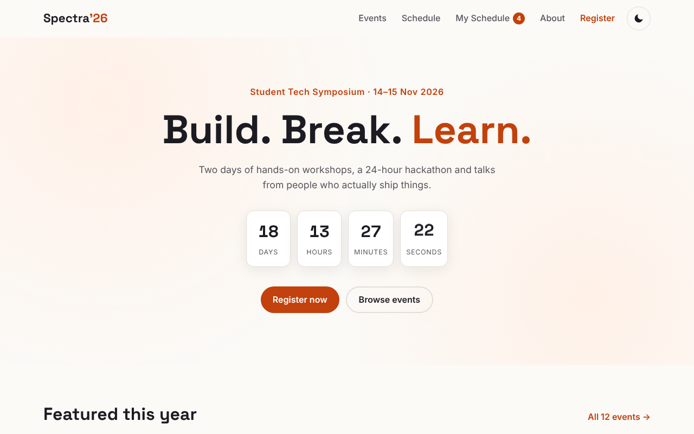
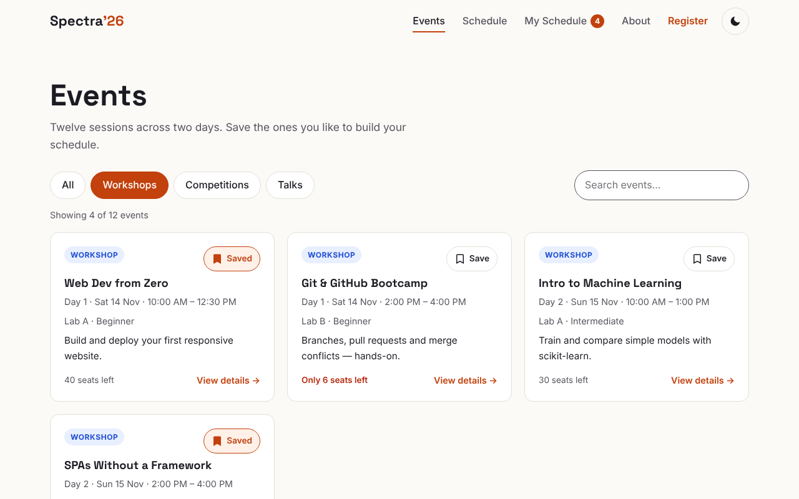
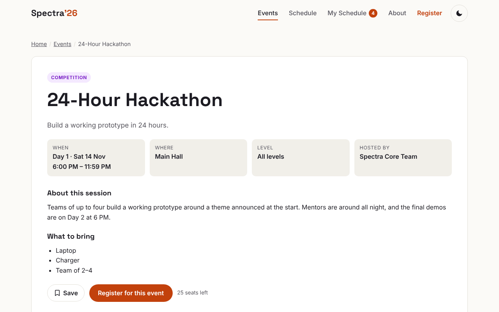
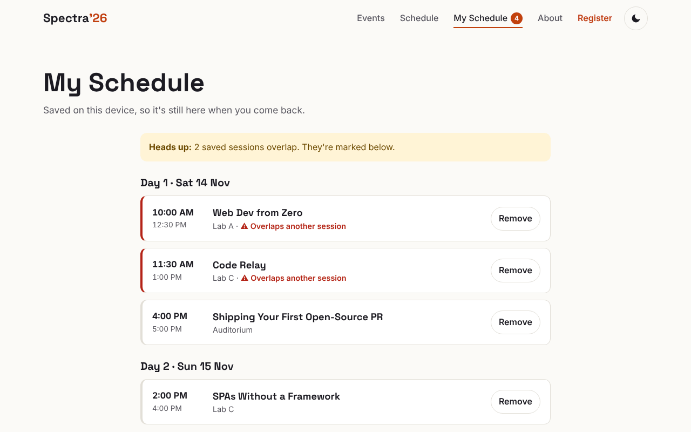
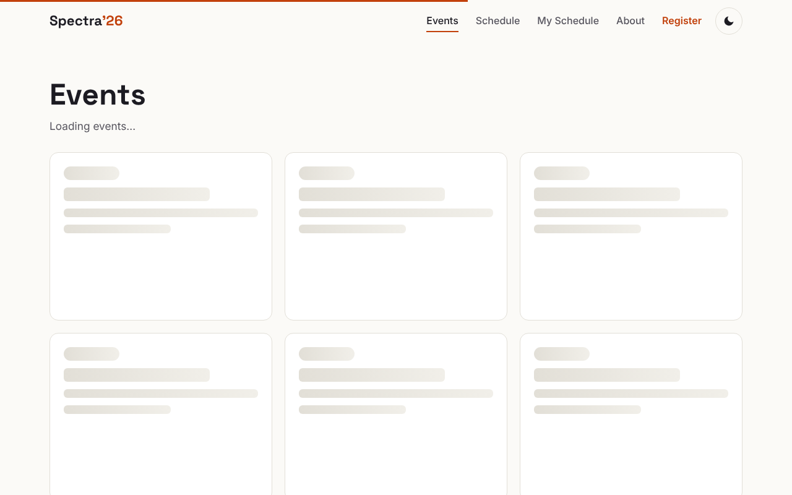
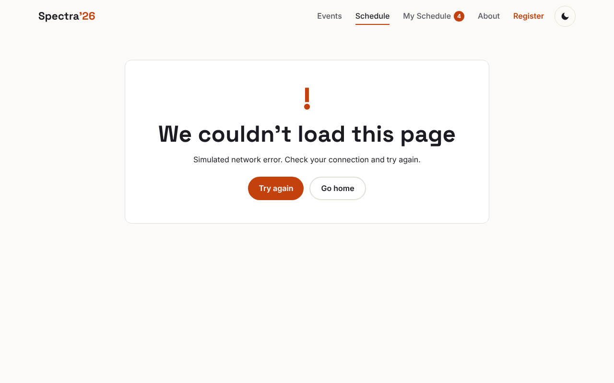
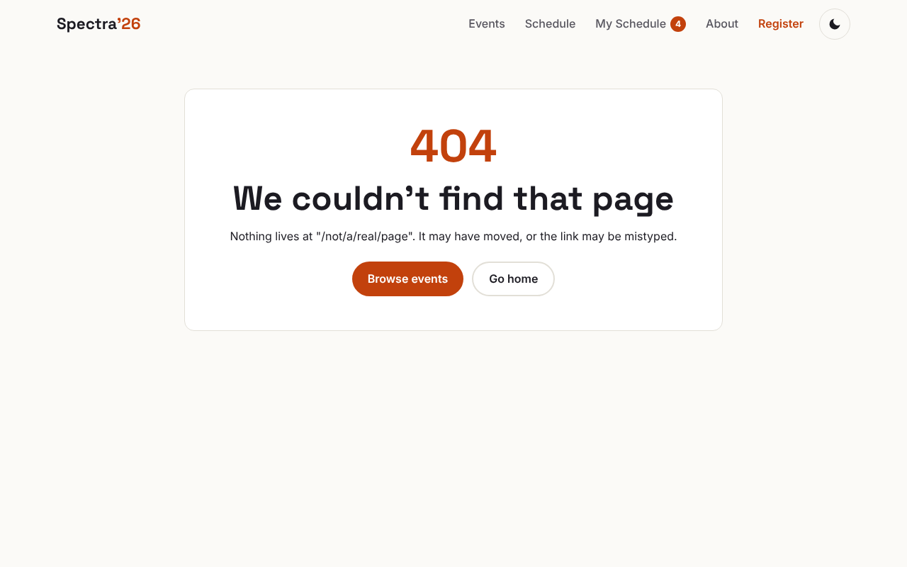
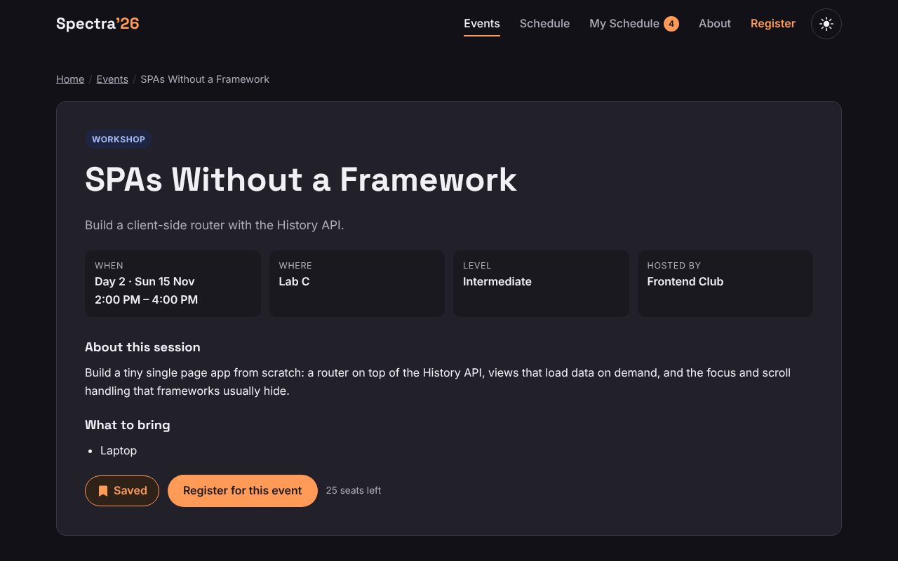

# Spectra '26 — Single Page Application (Week 5)

The Spectra '26 symposium site, rebuilt as a **single page application** in plain HTML, CSS and JavaScript, with no frameworks or libraries. Every page — home, events, event details, schedule, My Schedule, registration and about — is rendered by JavaScript inside one HTML page. The URL changes with every navigation, and the Back and Forward buttons work normally.


## Features

| Area | What it does |
|---|---|
| **Routing** | History API (`pushState`, `popstate`) with clean URLs like `/events/4` and `/schedule?day=2`. Includes dynamic routes (`/events/:id`), a 404 view, and a route guard on `/register/done`. |
| **Works anywhere** | Clean URLs on a web server, and automatic `#/hash` URLs when `index.html` is opened from disk. A `404.html` handles deep links on GitHub Pages. |
| **Dynamic loading** | Event data is loaded on demand (not in the first page load). It is cached, shared between views, prefetched on hover, and has a timeout. |
| **Loading & errors** | Skeleton cards and a progress bar while loading. An error view with **Try again** if loading fails. A 404 for unknown pages and event ids. |
| **State** | A small store with subscribe/setState. My Schedule (saved events) and the form draft persist in `localStorage` and stay in sync across open tabs. |
| **URL = state** | Filters and search live in the query string: a filtered list can be shared, survives a refresh, and Back steps through filters. |
| **Transitions** | View Transitions API cross-fade, with a CSS fallback. Reduced-motion is respected. |
| **Accessibility** | Focus moves to the new heading, page changes are announced to screen readers, the active link uses `aria-current`, and scroll is restored on Back. Both themes pass WCAG AA. |
| **Extras** | Clash detection in My Schedule, dark mode, mobile menu, a registration draft that survives leaving the page. |

## Results

- **48/48** end-to-end checks pass (`tests/e2e.py`).
- **0** axe-core violations across 11 routes × light/dark × desktop/mobile (44 audits).
- Lighthouse (mobile, median of 3 runs): **100 / 100 / 100 / 100** on every main route, with CLS 0 and about 100 KB total.
- In-app page switch: **~14 ms** (median), compared with ~445 ms for a full page load.

## Folder structure

```
├── index.html            # the single HTML page (app shell)
├── 404.html              # sends deep links back to the app on GitHub Pages
├── robots.txt
├── css/style.css
├── js/
│   ├── core/
│   │   ├── utils.js      # safe html`` templates, helpers
│   │   ├── store.js      # shared state + persistence + cross-tab sync
│   │   ├── api.js        # on-demand data loading, cache, errors
│   │   └── router.js     # History API / hash routing
│   ├── views/            # one file per page: load → render → mount → cleanup
│   │   ├── components.js
│   │   ├── home.js  events.js  event-detail.js
│   │   ├── schedule.js   register.js   about.js
│   └── app.js            # route table + render pipeline
├── data/events.js        # event data, loaded only when needed
├── fonts/                # self-hosted WOFF2 + licences
├── tests/e2e.py          # Playwright end-to-end tests
└── docs/
    ├── TECHNICAL_REPORT.md
    ├── architecture.svg
    ├── lighthouse/  axe/  screenshots/
```

## Run it

**Option 1:** double-click `index.html`. It runs in hash mode (`index.html#/events`).

**Option 2 (recommended):** use a local server for clean URLs:

```bash
npx serve .
# open http://localhost:3000
```

Use `serve` rather than VS Code Live Server. `serve` uses the project's `404.html`, so refreshing on a deep URL like `/events/4` works, the same as on GitHub Pages.

**Run the tests** while the server is running on port 8095:

```bash
npx serve . -l 8095
pip install playwright && python -m playwright install chromium
python tests/e2e.py
```

**Try the error handling** in the browser console:

```js
Spectra.api.failNext()          // next data load fails → error view with "Try again"
Spectra.api.setLatency(2000); Spectra.api.clearCache()   // next page loads slowly → see the skeletons
```

## Tech

HTML5 · CSS3 · Vanilla JavaScript (ES2020) · History API · View Transitions API · localStorage · Playwright · Lighthouse 13.5 · axe-core 4.14

## Screenshots

| | |
|---|---|
|  |  |
|  |  |
|  |  |
|  |  |

Full documentation: [docs/TECHNICAL_REPORT.md](docs/TECHNICAL_REPORT.md)
