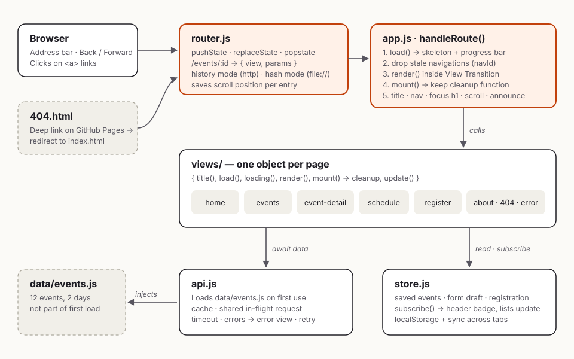

# Technical Report: Week 5 Single Page Application

**Project:** Spectra '26, a symposium site rebuilt as a single page application (SPA)
**Stack:** HTML5, CSS3, vanilla JavaScript; no frameworks, libraries or build step
**Testing:** Playwright (48 end-to-end checks), axe-core 4.14, Lighthouse 13.5, Chrome 153

---

## 1. Objective and what I built

The task was to build an SPA that loads and displays content dynamically without reloading the page, uses JavaScript to manage the browser history and the DOM, and moves smoothly between sections.

I rebuilt the Spectra '26 site from earlier weeks as a seven-page SPA. The pages are Home, Events, Event details, Schedule, My Schedule, Register (plus a confirmation page) and About, with a 404 page and an error page. One HTML file holds the "shell" (header, main area, footer). JavaScript decides what goes inside `<main>` based on the URL.

| Route | View | What it shows |
|---|---|---|
| `/` | home | Hero, live countdown, featured events (loaded after the hero) |
| `/events?type=&q=` | events | All events with category filter and search, both stored in the URL |
| `/events/:id` | eventDetail | One event; dynamic route; unknown ids → 404 |
| `/schedule?day=2` | schedule | Timetable for each day |
| `/my-schedule` | mySchedule | Saved events, clash warnings, remove |
| `/register?event=4` | register | Form with validation and an auto-saved draft |
| `/register/done` | registerDone | Confirmation; guarded (redirects if there's no registration) |
| `/about` | about | Venue map (inline SVG) and FAQ |
| anything else | notFound | 404 page |

---

## 2. Planning and key decisions

Before writing any code, I listed what an SPA has to do *for* the user that a normal website gets for free. That list shaped the whole design:

| A normal site does this for free… | …so my SPA has to do it itself |
|---|---|
| Each page has its own URL | Change the URL with `pushState`, and read it back on load |
| Back / Forward work | Listen to `popstate` and re-render |
| Refresh or sharing a link opens the same page | Deep links must work, including on GitHub Pages |
| A new page starts at the top; Back returns to where you were | Save and restore scroll positions per history entry |
| Screen readers announce the new page | Move focus to the new heading and announce the change |
| The tab title changes | Set `document.title` per view |
| Loading a page shows progress | Show skeletons and a progress bar; handle errors |

The main design decisions:

| Decision | Why |
|---|---|
| **No framework** | The task is about understanding the History API and the DOM, which frameworks hide. |
| **Plain `<script defer>` files, not ES modules** | Browsers block ES modules on `file://`. An evaluator who double-clicks `index.html` would see a blank page. Classic scripts under one `Spectra` namespace work everywhere. |
| **History API, with a hash fallback** | Clean URLs (`/events/4`) on a server. `file://` pages can't `pushState` to new paths, so the router switches to `#/events/4` there automatically. |
| **Data loaded by injecting `data/events.js`** | `fetch()` is also blocked on `file://`. A script tag works in both cases and still means the data isn't part of the first load. |
| **One "contract" for every view** | Every view is an object with `title()`, `load()`, `loading()`, `render()`, `mount()` (which returns a cleanup function) and optionally `update()`. The app treats all pages the same way. |
| **A tiny store instead of global variables** | Views never talk to each other directly. They read and subscribe to shared state, so a Save button on one page updates the header badge and My Schedule automatically. |

---

## 3. Architecture

**What happens on one navigation:**

1. A click on any internal `<a>` is intercepted by `router.js`. External links, new-tab clicks (Ctrl/Cmd), downloads and `target` links are left to the browser.
2. The router saves the current scroll position into `history.state`, calls `history.pushState()`, matches the new path against the route table, and calls `handleRoute()` in `app.js`.
3. `handleRoute()` gives the navigation an id and calls the view's `load()`. While it waits, a progress bar runs. If loading takes longer than 120 ms, the view's skeleton is shown, so fast loads don't flash.
4. If a newer navigation started in the meantime, this one is **dropped** (see 8.3).
5. `render()` returns an HTML string. The old view's cleanup function runs, the new HTML is swapped in inside a **View Transition**, and `mount()` attaches the view's event listeners and returns its own cleanup function.
6. Then the app updates the title and the active nav link, sets the scroll position (top for new pages, the saved position for Back/Forward), moves focus to the page `<h1>`, and announces the new page to screen readers.

Back and Forward fire `popstate`, which runs the same `handleRoute()`.

---

## 4. Routing in detail

**Route matching.** Patterns like `/events/:id` are compiled once into regular expressions, and the parameter names are kept, so `/events/4` gives `{ id: '4' }`.

**Building links.** No view writes a URL by hand. They call `router.href('/events/4')`, which returns `/events/4`, `/week5-spa/events/4` on GitHub Pages, or `#/events/4` from disk. The same view code works in all three cases.

**Query-only changes update in place.** If only the query string changes (for example `?type=talk` → `?type=workshop`, or Back between filters), the app calls the view's `update()` instead of rebuilding the page. Focus, scroll and the search box stay where they are. The tests check that the search input is the *same element* after Back.

**Search vs. filter history.** Clicking a category creates a history entry, so Back undoes it. Typing in search uses `history.replaceState()`, so Back doesn't step through every keystroke. Both keep the URL shareable.

**Deep links and refresh.**
- **GitHub Pages** only serves real files, so `/week5-spa/events/4` would be a 404. The host serves my `404.html` instead, which saves the wanted path in `sessionStorage` and redirects to the app root. The router then restores the original URL with `replaceState` and shows the right view.
- **Relative paths:** at a deep URL, `css/style.css` would resolve to `/events/css/style.css`. An inline script works out the app's root folder and adds a `<base href>` before anything else loads.

**Route guard.** `/register/done` throws `S.redirect('/register')` from its `load()` when there is no registration. The app then *replaces* the history entry, so Back doesn't land on the guarded page again.

---

## 5. Dynamic content loading

`api.js` is the only place that knows where data comes from:

- **On demand:** event data isn't in the first page load. The first view that needs it triggers the download.
- **Cached:** after the first load, every view gets the data instantly. That's why in-app navigation takes ~14 ms.
- **Shared in-flight request:** if two views ask for the data at the same moment, they share one request instead of loading it twice.
- **Prefetch:** hovering or focusing a link to Events, Schedule or Register starts loading the data before the click.
- **Timeout and errors:** a request that takes over 8 seconds, or a script that fails to load, rejects the promise. The app then shows the error view with **Try again**. A failed load is not cached, so retrying makes a fresh request.
- **Not found:** `getEvent()` returns `null` for unknown ids, and the detail view throws `S.notFoundError()`, which shows the 404 page instead of a broken one.
- **Progressive rendering:** Home doesn't wait for data. The hero appears immediately, and the featured events fill in their own section when the data arrives.

---

## 6. State management

`store.js` creates a small store with `getState()`, `setState()` and `subscribe()`:

| State | Persisted? | Used by |
|---|---|---|
| `saved` (event ids) | localStorage | Save buttons everywhere, header badge, Schedule, My Schedule |
| `draft` (form fields) | localStorage | Register — restores what you typed if you leave and come back |
| `registration` | localStorage | Confirmation page and its route guard |
| `lastEventsQuery` | memory | The breadcrumb's "Events" link returns to your last filter |

- **Updates flow one way:** a view calls an action (`toggleSaved`), the store changes, and every subscriber reacts. The event page doesn't know the header badge exists.
- **Cross-tab sync:** the store listens for the browser's `storage` event, so saving an event in one tab updates the badge and My Schedule in another open tab.
- **The URL is state too:** filters, search, day and event id live in the URL rather than the store, because they should survive a refresh and be shareable.
- **Clash detection:** My Schedule compares every pair of saved sessions on the same day. If one starts before the other ends, both are marked "Overlaps another session".

---

## 7. Transitions and user experience

- **View Transitions API:** the old page fades out and the new one slides up slightly. The header has its own `view-transition-name`, so it stays still. Browsers without the API get a CSS animation instead, and everything is turned off when the user prefers reduced motion.
- **Focus management:** after each navigation, focus moves to the new `<h1>` (`tabindex="-1"`), so keyboard and screen-reader users start at the new content instead of being stuck on the old link. Focus is *not* moved on the first page load.
- **Announcements:** a visually hidden `aria-live` region says "Events, page loaded" after each navigation.
- **Scroll:** I set `history.scrollRestoration = 'manual'` and handle scrolling myself: new pages start at the top, and Back/Forward return to the saved position.
- **Active link:** `aria-current="page"` marks the current section in the nav, and CSS draws the underline from that attribute.
- **Loading states:** skeleton cards have the same height as real cards, so nothing jumps when the data arrives.

---

## 8. Robustness

### 8.1 Safe HTML
All views use a tagged template, `` html`...` ``, that escapes every value placed inside it. Event titles or a user's name can never inject markup, even though views build their HTML as strings.

### 8.2 Cleanup (no leaks)
`mount()` returns a cleanup function, which the app calls before the next view replaces it. Home's countdown interval, the store subscriptions and the `visibilitychange` listener are all removed when you leave a page. A test wraps `setInterval` and checks that the count goes back to 0 after leaving Home.

### 8.3 Race conditions
If someone clicks Events (slow) and then About (fast), the Events data might arrive *after* About is shown. Every navigation gets an increasing `navId`, and an async step that finishes after a newer navigation started is discarded. The search box uses the same idea, so an older, slower search can't overwrite a newer one.

---

## 9. Testing and results

### 9.1 End-to-end tests: 48/48 pass
`tests/e2e.py` (Playwright) checks:
- **Routing:** URL changes, titles, `aria-current`, focus and announcements.
- **URL-driven state:** filters, Back through filters, search that doesn't add history entries, refresh.
- **Navigation details:** scroll restoration, deep links to four routes, 404s for unknown URLs and ids.
- **Robustness:** the error view and retry, race conditions.
- **State:** save/badge/clash/remove with focus handling, cross-tab sync.
- **Register:** form prefill from an event page, draft persistence, validation, submit, the route guard.
- **Other:** interval cleanup, mobile menu and layout, and `file://` hash mode with Back/Forward.

The whole suite also passes on a server that returns `index.html` for every path (`serve -s`), not only on the `404.html` setup.

### 9.2 GitHub Pages simulation
I mapped a `*.github.io` hostname to a local server hosting the app under `/week5-spa/`. A **cold deep link** (`/week5-spa/events/4?from=share`, nothing stored) opened the right event with the query string preserved, and refreshing on `/week5-spa/register?event=4` kept the page and the pre-selected event.

### 9.3 Accessibility: 0 violations
axe-core ran on 11 routes (including the form's error state, the 404 page and the confirmation page) in light and dark mode at 1280px and 390px: **44 audits, 0 violations**.

### 9.4 Lighthouse (mobile, median of 3 runs)

| Route | Perf | A11y | Best Pr. | SEO | LCP | CLS | Size |
|---|---|---|---|---|---|---|---|
| `/` | 100 | 100 | 100 | 100 | 1.67 s | 0 | 102 KB |
| `/events` | 100 | 100 | 100 | 100 | 1.71 s | 0 | 102 KB |
| `/events/4` | 100 | 100 | 100 | 100 | 1.67 s | 0 | 102 KB |
| `/schedule` | 100 | 100 | 100 | 100 | 1.66 s | 0 | 102 KB |
| `/my-schedule` | 100 | 100 | 100 | 100 | 1.66 s | 0 | 102 KB |
| `/register` | 100 | 100 | 100 | 100 | 1.65 s | 0 | 102 KB |
| `/` (desktop) | 100 | 100 | 100 | 100 | 0.42 s | 0 | 102 KB |

### 9.5 The point of an SPA, measured
Switching pages inside the app took **14 ms** (median of 24 switches, data already cached). A full page load until the view was ready took **~445 ms** locally, about 300 ms of which is the artificial delay I added to the data load to make the loading states visible.

---

## 10. Challenges and how I solved them

1. **CSS and scripts broke on deep URLs.** At `/events/4`, the browser resolved `css/style.css` as `/events/css/style.css`. I added a `<base href>` computed at runtime, so the same files work at `/` locally and at `/week5-spa/` on GitHub Pages.

2. **Every file was downloaded twice on deep links.** Lighthouse showed **32 requests instead of 17** on `/events/4`. The browser's preload scanner reads `<link>` and `<script>` tags *before* my inline script adds `<base>`, so it fetched `/events/css/style.css` first and the correct file second. I now write those tags from the inline script, after `<base>` exists. Requests dropped back to 17.

3. **Finding the app root on different hosts.** My first version took the root from the folder of the current URL. On hosts that serve `index.html` for every path (Netlify, Vercel, `serve -s`), a deep link made it guess `/events/` as the root. The root detection now recognises the app's own route names, and remembers the root from the last visit as a fallback.

4. **Opening the file directly.** `file://` blocks ES modules, `fetch()` and `pushState()` to new paths. Classic scripts, script-tag data loading and automatic hash routing keep the app working when it's simply double-clicked.

5. **Layout shift of 0.125 on every page.** Lighthouse pointed at the footer. Before the first view rendered, `<main>` was empty and the footer sat on screen, then jumped down. The featured skeleton cards were also 154px tall while real cards were about 260px. A minimum height on `<main>` and matching card heights brought CLS to **0**.

6. **The mobile menu closed itself.** If you opened the menu while a page was still loading, it snapped shut when the data arrived, because I closed it at the *end* of navigation. It now closes when navigation *starts*.

7. **A "0" badge was visible although it was `hidden`.** My `.badge { display: inline-grid }` rule overrode the `hidden` attribute. I added `.badge[hidden] { display: none }`.

8. **Skipped heading level.** axe flagged `<h1>` → `<h3>` on the events and schedule pages. A visually hidden `<h2>` before each list fixed the outline without changing the look.

9. **Focus lost after removing an item.** In My Schedule, the Remove button disappears when the list re-renders, which would drop keyboard focus to the top of the page. I record the *neighbouring* item's id before removing, then focus its button in the new list.

10. **A cleared draft came back.** The form saves a draft 300 ms after typing (debounced). Submitting cleared the draft, but the pending save then wrote it back. I spotted this while writing the code and added a `submitted` flag.

11. **My tests had bugs too.** Three early failures were in the tests, not the app:
    - A selector matched the skeleton cards, so a test continued before the data had arrived.
    - Hovering a link triggered the prefetch, which used up the simulated failure. This showed that a failed prefetch doesn't break the real request that follows.
    - Playwright scrolls an element into view before clicking it, which changed the scroll position the test had recorded.

    I fixed each test so it measures what it claims to.

---

## 11. Limitations and next steps

- **No backend:** registrations are stored only in the browser. A real version would POST to an API.
- **Deep links on GitHub Pages return HTTP 404 first.** Visitors don't notice, but search engines might. A host with SPA rewrites (Netlify, Vercel) would avoid it, and the app already supports that.
- **VS Code Live Server** doesn't use `404.html`, so refreshing on a deep URL there shows Live Server's own 404. `npx serve` behaves like GitHub Pages.
- **Next steps:** server-side rendering of the first view, and a service worker for offline use.

## 12. What I learned

Building the router myself showed me how much a browser does for a normal website: URLs, history, scroll, focus, titles, loading feedback and error pages. An SPA has to rebuild each of these on purpose, or users quietly lose them. The hardest bugs weren't in the routing logic but at the edges: how relative URLs resolve, what the preload scanner does before my scripts run, and what different hosts do with a URL that isn't a file.

Writing automated tests for every behaviour, and measuring with Lighthouse and axe after every change, is what made me find those problems instead of discovering them after submission.
